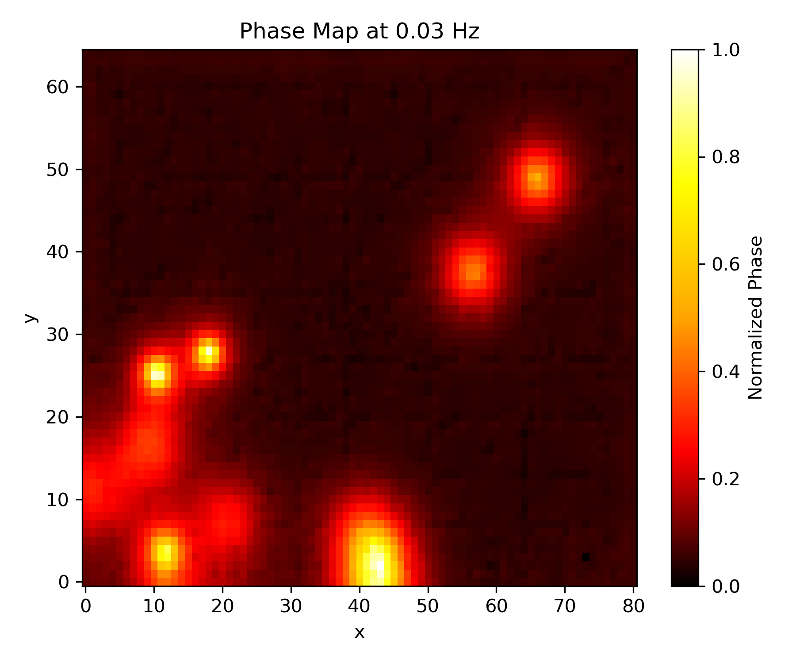
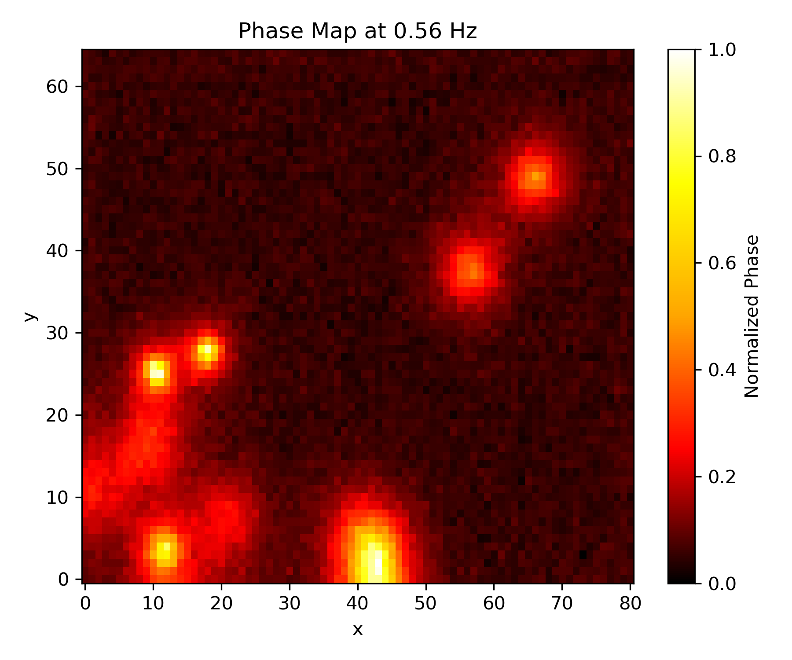
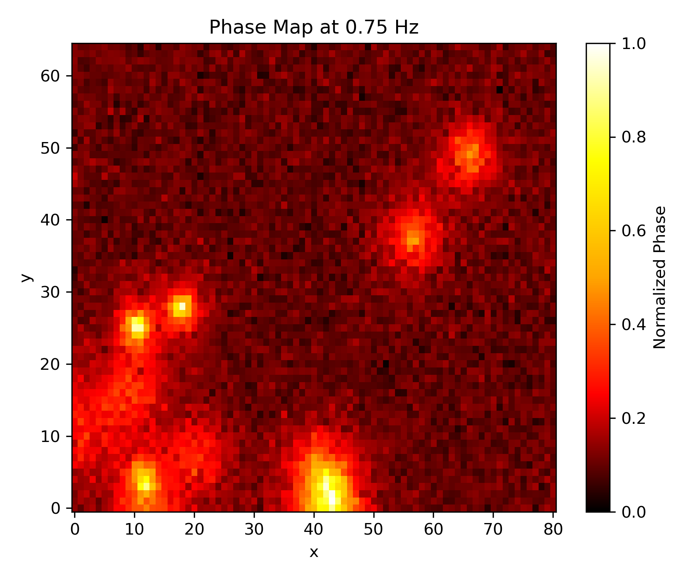
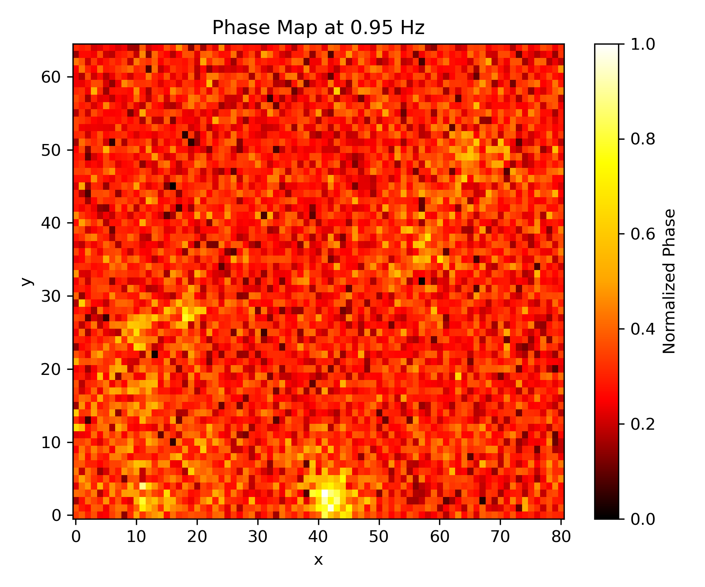
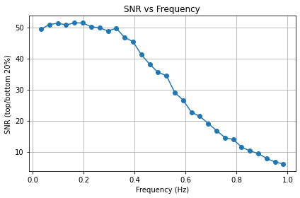

# Nanoparticle Dispersion Analysis Using Pulsed Phase Thermography

## Overview

This project investigated the effectiveness of Pulsed Phase Thermography (PPT) as a non-destructive testing technique for evaluating carbon nanotube dispersion within epoxy resin nanocomposites.

The work involved developing Python scripts to automate thermal simulations within Abaqus, processing large temperature-time datasets, and applying frequency-domain analysis to generate phase maps capable of revealing underlying nanoparticle dispersion characteristics.

## Objectives

- Simulate heat flow through nanocomposite materials
- Investigate the effectiveness of Pulsed Phase Thermography
- Analyse carbon nanotube dispersion patterns
- Compare generated phase maps with known nanoparticle distributions
- Evaluate optimal inspection frequencies using quantitative analysis

## Methodology

### Thermal Simulation

Python scripts were developed to automate thermal simulations within Abaqus.

Pulsed heating was applied to nanocomposite samples containing varying nanoparticle distributions. Simulations generated temperature-time data across a two-dimensional spatial grid over multiple time intervals.

### Data Processing

Thermal response data were extracted and processed into temperature-time datasets suitable for frequency-domain analysis.

### Frequency Analysis

Fast Fourier Transform (FFT) techniques were applied to the thermal response data in order to generate phase maps across a range of frequencies.

Signal-to-noise ratio (SNR) analysis was also performed to identify frequencies that provided the strongest contrast between dispersed and non-dispersed regions.

## Results

The resulting phase maps successfully identified underlying nanoparticle dispersion patterns and demonstrated the potential effectiveness of Pulsed Phase Thermography as a non-destructive evaluation technique for nanocomposite materials.

## Example Phase Maps

The following phase maps were generated using Fast Fourier Transform (FFT) analysis of simulated thermal response data. Each image represents the phase response at a different frequency and highlights the ability of Pulsed Phase Thermography to reveal underlying nanoparticle dispersion patterns.

<table>
<tr>
<td align="center">
<b>0.03 Hz</b> 
 
<em>Phase map generated at 0.03 Hz.</em>
</td>

<td align="center">
<b>0.56 Hz</b> 
 
<em>Phase map generated at 0.56 Hz.</em>
</td>
</tr>

<tr>
<td align="center">
<b>0.75 Hz</b> 
 
<em>Phase map generated at 0.75 Hz.</em>
</td>

<td align="center">
<b>0.95 Hz</b> 
 
<em>Phase map generated at 0.95 Hz.</em>
</td>
</tr>
</table>

---

### Signal-to-Noise Ratio Analysis

*Signal-to-noise ratio evaluation used to identify the most effective frequencies for dispersion detection.*

## Technologies

- Python
- Abaqus
- Fast Fourier Transform (FFT)
- Scientific Computing
- Data Analysis
- Data Visualisation

## Skills Demonstrated

- Python Programming
- Numerical Simulation
- Scientific Computing
- Signal Processing
- Data Analysis
- Research
- Problem Solving

## Internship Project

This work was completed during a summer research internship investigating non-destructive evaluation techniques for nanocomposite materials.
